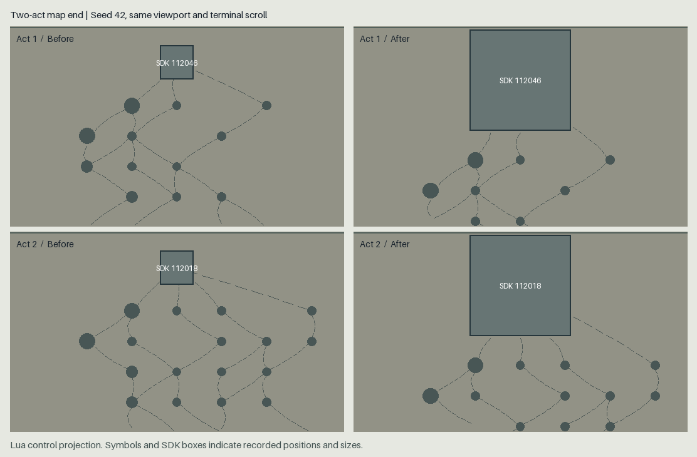

# 原版地图首领徽记对照

TASK-4.13.2 基于主仓 develop `32a15219aecd145c59cb1b2fcf477e5556766e5d`，在 Fork A 独立交付。两幕的六款现有首领图库资源保持原绑定。[本作图库来源与对应关系](../../art/NATIVE_ENEMY_PORTRAITS.md)



原版原图为 Cornell 课件第 35 页的 Slime Boss 地图截图。提取图分辨率为 1045×675，使用左上为原点和灰阶 95 阈值，在徽记（294, 4）至（553, 241）以及五个末排营地的范围内量测，取营地宽度中位数。画纸右缘约在 x=840，截图裁到徽记上缘，纵向数值取近似。Hexaghost 和 Slime Boss 的局部图另外用于核对不同徽记轮廓及多条虚线接近终点的构图。[Cornell 原版截图](https://www.cs.cornell.edu/courses/cs5152/2026sp/lectures/lecture14/slides-14.pdf#page=35) · [ITB 第 3 页图 6–7](https://informatika.stei.itb.ac.id/~rinaldi.munir/Stmik/2020-2021/Makalah2021/Makalah-Stima-2021-K1%20%2850%29.pdf#page=3) · [原版独立绘制与命中参数](https://github.com/aeubanks/sts/blob/319009d5df0a82d9fb0f23cc22322286c6a87ec0/map/DungeonMap.java)

| 几何 | 《杀戮尖塔1》截图可见墨迹 | 本作基线控件 | 本作候选控件 |
| --- | ---: | ---: | ---: |
| 首领宽度 | 约 249 px | 83.16 | 252.00 |
| 普通营地宽度（未高亮） | 20 px | 21.84 | 21.84 |
| 首领宽度 ÷ 普通营地宽度 | 约 12.45 倍 | 3.81 倍 | 11.54 倍 |
| 首领宽度 ÷ 画纸宽度 | 约 29.6% | 9.92% | 30.07% |
| 首领与末排营地中心差 | 约 205 px | 108 | 200 |

候选在两幕的地图横向中心放置单张 252×252 的既有图库图，保持 126×126 选择区。完整徽记距各自视窗上缘 8，入场虚线裁到徽记外 6。末排营地自动聚焦到地图终点，仍可在同一视口点选首领。徽记以透明度反馈按下与悬停，尺寸固定。原版栏是截图墨迹，本作栏是图库控件外框。不同图库图的透明边距及最终轮廓仍待实际客户端核验。

## 复现

在基线和候选工作树中分别生成官方布局，均使用 seed `42`、第一幕第 14 层、第二幕第 31 层和各自滚动上限。采集入口为 `tests/lua/support/map_boss_emblem.lua`，可从候选树取得，并在两个工作树执行。`Fengari` 构建真实地图和控件树，Pillow 仅绘制空间占位框和记录的虚线。原版截图及图库像素仅通过来源链接提供。

```sh
node scripts/build-ui.mjs build/map-visual --official-assets
node --input-type=module -e "import {buildLuaData} from './scripts/build-lua-data.mjs'; buildLuaData('data','build/map-visual/abyss_data.lua')"
LUA_PATH='build/map-visual/?.lua;src/lua/?.lua;;' node node_modules/fengari-node-cli/src/lua-cli.js -e 'assert(loadfile("/path/to/candidate/tests/lua/support/map_boss_emblem.lua"))("capture")' > capture.log
python docs/evidence/sts1-boss-emblem-20261127/compare.py before.log after.log docs/evidence/sts1-boss-emblem-20261127
```

> 使用两个工作树的 `capture.log` 作为 `before.log` 和 `after.log`。官方布局构建需要仓库中已有的 LFS 素材。原版截图可通过 `pdfimages -f 35 -l 35 -png slides-14.pdf original` 提取。

## 定向验证

- `node --test tests/map-boss-emblem.test.mjs` 通过 12 个组合。覆盖两幕六个首领、鼠标和触摸事件、末排聚焦、入线路径、裁切和重复点击。实际生产布局保留 92 个节点池及 126 个连线池。 [四个投影的量测数据](measurements.json)
- 地图章节 38 组、地图指针导航、正式两幕和图库状态回归通过。日常打包检查中生产控件仍为 15,713，模板仍为 54,483 字节，Lua 增 868 字节，布局 JSON 增 2,024 字节。最大单张绘制矩形约增加 5.66 万逻辑像素。
- `v25-map-layout.test.mjs` 有两项历史回放失败，在同一生产基线也复现。保留既有历史断言和固定前驱。全量 Hosted CI、官方导入、当前 ready、实际 GPU 负载与实体设备触控待验。
