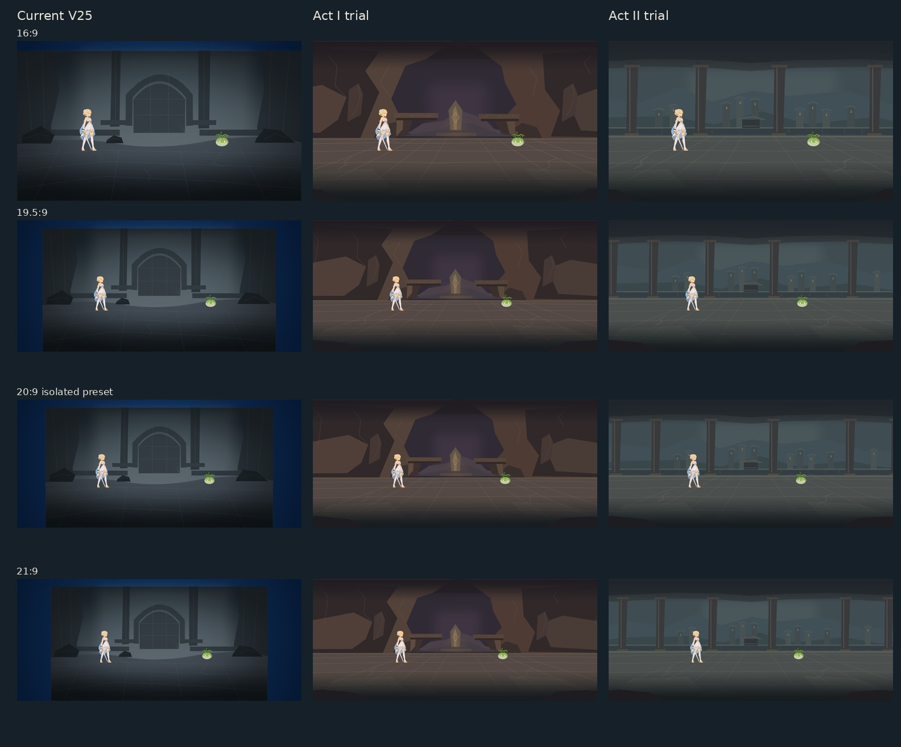

# v2.2.0 两幕战斗背景试制

适用任务为 TASK-115.7.2 和 TASK-115.7.3。工程基线为 cba3950a。本轮交付画面试制和实际 Simulator A/B，正式舞台待联合验收。

| 版本 | 修订 | 用途 |
| --- | --- | --- |
| v2.1.1 至当前 develop | V25 共用背景 | 正式现行稿及此次修改前对照 |
| v2.2.0 | production-size-native-scene-v2 | 当前试制稿，使用项目原创岩脉封印和玉渠廊台。待独立评审与正式场景验收 |
| v2.2.0 | production-size-native-scene-v1 | 已替代。该版本底缘存在亮线，连续墙地接缝和明暗已重绘 |
| v2.2.0 | normalized-pilot | 已替代。其荧使用 133px 标定画幅，试制证据统一使用 210px 正式显示尺寸 |
| v2.2.0 | contact-trial | 仅接地对照，保留同图开关，正式启用待审 |

原版一幕遗迹、二幕柱廊的地线和层级参照已由 TASK-115.7.1 实际读图标注。岩封石碑、浅紫裂隙与卡区边缘的石渣使用本项目岩元素遗迹身份。二幕使用青灰玉渠廊台、远山和小面暖窗。两幕背景使用本仓原创几何。现行 V25 相同战斗场景由 applyV25BattleScene 注入，在正式生成路径代替旧 lowpolyScene。[原版图像与坐标参照](https://github.com/FurinyaDev/Slay-the-Heavens-Fork-A/tree/1273cf6af2aea0ab1adcdc1415e774c714e249e8/docs/design/reference-assets/v2.2.0/battle-scene) · [现行合成入口](../../../scripts/v25-battle-scene.mjs)

## 画面参数

- 以 1280×720 中心对齐逻辑舞台。两侧绘制至 x=−400 和 x=1680。绘制范围与击中区尺寸独立。固定缩放取 min(canvasWidth/1280,canvasHeight/720)，人物和地面同比例，宽出的空间由画面覆盖。
- 一幕墙地后沿 y=437，以暗岩、墙缝、石碑及低对比暖岩地面表示进深。二幕栏廊后沿 y=426，以较冷远景、暗柱、栏台和低亮窗灯分出前后。坡面在 y≥535 压暗，地缝近处拉开。重点图案不遮挡顶部文字、主体头部及手牌常态范围。
- 实际测量当前正式荧在 210px 逻辑显示槽中，独立 210 像素样本的两脚距离槽中心向下约 93 像素。两幕共用 y=493 目标脚线。固定荧 x=320、小酸叶团 x=923。同一视口的三张背景运行同一原生角色及怪物 Lua，位置、规模、控件和状态固定。小酸叶团下沿约 y=475，在这个背景隔离对照中有意悬空。实际战斗的接地锚点待独立测量。
- 控件物料使用现有矩形、三角形、渐变和径向光。现行 V25 有 261 个背景树节点。试制每次挂一个场景，一幕 236 节点，二幕 257 节点。可选接地层各加 1。计数包含容器，实际包体、分配和 FPS 待测。

## 实际证据

三种现有预设 16:9、19.5:9、21:9 与 20:9 隔离本地预设运行于 BeyondSimulator MCP 0.5.2。每组均取得生产角色 painter 的 ACTOR_ALPHA_READY hero=473 monster=32 日志、符合预设的 PNG 尺寸和无缺失资源警告的截图收据。横向比较采用同一荧和同一小酸叶团隔离背景因素。21:9 保持等比场景和角色，候选两个外边缘继续显示岩壁、远景及石地。正式战斗手牌、HUD、复杂敌阵及触控尚待联合验收。

| 宽高比 | 画布 | 实际渲染 |
| --- | --- | --- |
| 16:9 | 1280×720 | 现行 V25、第一幕、第二幕 |
| 19.5:9 | 1560×720 | 现行 V25、第一幕、第二幕 |
| 20:9 | 1600×720 | 现行 V25、第一幕、第二幕，使用隔离预设 |
| 21:9 | 2100×900 | 现行 V25、第一幕、第二幕 |

[原始运行收据及 PNG 指纹](comparisons.json) · [试制几何](../../../scripts/v220-battle-scene-geometry.mjs) · [运行入口](../../../experiments/v220-battle-scenes/capture.mjs)

原始输入为 TASK-115.7.4 正式尺寸 pilot 的 page-1-battle.save.json，SHA-256 为 f886508da7b72d508c1b95dd8a66bf092a593900e7049e35653faa3fb63e9008。共享环境在本次工作树的 .artifacts/v220-scenes-v2b-stock、.artifacts/v220-scenes-v2b-20-9 和 .artifacts/v220-scenes-v2b-contact 保存原始存档、PNG 和回执。汇总图使用原始 PNG 等比缩小，原图身份以回执摘要为准。

    ART_LAB_MCP_ENTRY=/path/to/beyond-simulator-mcp/dist/index.js \
      node experiments/v220-battle-scenes/capture.mjs "/path/to/page-1-battle.save.json" \
      .artifacts/scene-captures mobile-16-9 mobile-19.5-9 pc-21-9

运行 20:9 时，在另一个 0.5.2 安装副本的 dist/index.js 和 dist/worker.js 中把 mobile-4-3 预设的键与 ID 换为 mobile-20-9，宽高为 1600、720，比例改为 20:9。这两个声明之外使用原模拟器运行路径。接地对照以同一输入加 --contact-trial mobile-16-9。

末行与倒数第二行的 RGB 最大通道差以中央 40% 宽度计算 P95。四种画布的两个候选均 ≤2，现行 V25 为 20–28。地面接缝横贯中央，不再留下对齐的空隙。一幕以扶壁支撑两块石沿，背景区分暖岩和冷紫远景。二幕降低远处雾层亮度，并保留栏柱明暗和稀疏暖窗。

接地对照单独加入一个椭圆，中心位于荧脚线。两幕实际差值分别为 464 和 459 像素，均只在 x=279–361、y=489–498。最大通道变化为 13 和 12。这个变化轻微，当前两个候选默认使用无额外阴影的画面，等待独立视觉评审与正式动态场景复看。

## 正式接入待验

以战斗幕次创建当幕所需背景，切幕后回收旧背景。核对源码体积、动态创建、连续进出和官方容量。候选控件计数适用于单个背景活跃的场景，生产数据同时打包的容量和正式构建帧时待测。按荧、地面敌人、浮空和大体型敌人联合验证进退场、出牌和意图时的位置、触控与背景关系。按同一候选补齐 HUD、不同敌群和宽高比的正式视觉报告，由独立视觉评审确认。
