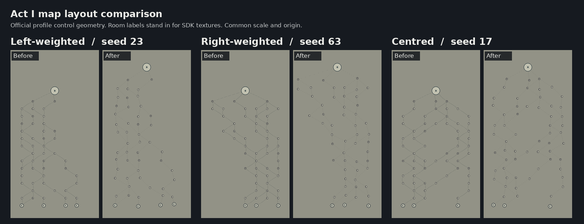

# v2.3.0 地图布局离线证据

TASK-116 · 固定基线 `32a15219aecd145c59cb1b2fcf477e5556766e5d`。采用 STS1 实际反编译源码及三张不同种子的原版画面作为参照。 [源码、实拍和适配参数](REFERENCE.md)



前后图使用正式配置生成的控件，通过真实 Lua MapUI 绘制并导出坐标、尺寸与颜色。图中房型字母代替 SDK 纹理，六幅图共用横纵比例和原点。前三组对应基线第一幕最偏左、最偏右和居中的种子；原版实拍来自另几个种子，用来比较布局和画法。

| 离线检查 | 基线 | 候选 |
| --- | ---: | ---: |
| 种子 × 幕 | 128 × 3 | 128 × 3 |
| 常规节点横向质心的绝对偏移均值 | 40.28 | 16.63 |
| 常规节点横向跨度均值 | 664.71 | 711.39 |
| 渲染遍历 | 2,816 | 2,816 |
| 绑定及首绘平均 Lua CPU 时间 | 1.018 ms | 0.885 ms |
| 滚动重绘平均 Lua CPU 时间 | 0.862 ms | 0.635 ms |
| 最大节点数 / 已画路线数 | 74 / 85 | 74 / 85 |
| 正式配置生成控件数 / 单容器最多子控件 | 26,714 / 60 | 26,714 / 60 |
| 本地打包 Lua 输入大小 | 5,511,922 B | 5,516,970 B |

384 份地图快照逐字节一致，包含节点、房型、拓扑和地图 RNG 状态。遍历验证同一节点滚动时绝对坐标稳定，热区无重叠，所有可绘房间和路线均能滚动进入视野；常规连线中心线交叉数为零。触控探针按 2556×1179 和正式移动 HUD 的地图上缘，在三个种子上验证选点、跨触点拒绝、背景拖动、回焦、上限首领及存档恢复后触区位置。同一正式配置的生成布局和模板逐字节一致，包含 HUD 与图例。 [批量结果](batch-summary.json)

CPU 时间来自同机 Lua 5.3.6 的纯离线控件仿真，包含原有写入流程。官方编辑器容量、实际渲染帧率和实体触屏待同一候选验收。Draft 保持独立评审状态。

## 复现

在基线和候选各自的工作树执行。首次使用先安装仓库锁定依赖并拉取构建所需 LFS 对象。两轮分别设置各自的 `ARTIFACT`，并让 `PROBE` 指向候选工作树的 `probe.lua`。

```sh
node scripts/build-lua-data.mjs data "$ARTIFACT/lua/abyss_data.lua"
node scripts/build-ui.mjs "$ARTIFACT/lua" --official-assets --native-page-lifecycle
LUA_PATH="$ARTIFACT/lua/?.lua;src/lua/?.lua;;" lua5.3 "$PROBE" > "$ARTIFACT/batch.tsv"
MAP_CAPTURE='23 63 17' LUA_PATH="$ARTIFACT/lua/?.lua;src/lua/?.lua;;" lua5.3 "$PROBE" > "$ARTIFACT/draw.tsv"
```

用 Pillow 渲染并比对两份批量日志。

```sh
python docs/evidence/v2.3.0-map-layout/compare.py "$BEFORE" "$AFTER" "$REPORT"
```
