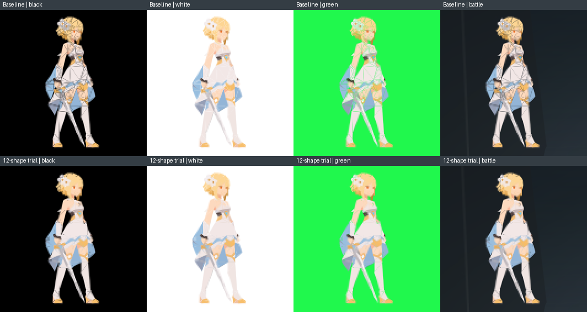

# v2.2.0 角色内部透明度实测

适用 TASK-115.7.4 / TASK-115.7.5。采样源码为 `27e2f8304bcbaedffa0efbc02d739bd4aeab38b6`，正式美术配置为 `official-assets-battle-v3`。本次记录可复用的检测和补色实验，正式修复继续待验。

## 渲染与判定

- 用 BeyondSimulator 0.5.2 的手动试玩时钟，在 1280×720 渲染岩荧和 42 个正式敌人。同样的几何依次在黑、白及高对比绿底渲染，逐图绑定存档、PNG 摘要、帧号及渲染警告。 [全量静态图元截图回执](static-roster.json)
- 岩荧和小型酸叶团另走实际生产 Lua 绘制模块。在探针中固定角色 133 px、敌人 106 px，用来源画布登记像素位置。岩荧创建 473 个原生控件，酸叶团绘制 32 个图元，黑白两底的结果和同几何静态探针逐像素相同。补采当前正式共用战斗背景，背景纹理读回无警告。 [原生产图元回执](runtime-baseline.json)
- 全部 43 个正式演员随后以相同画布和三个测试色调用生产 Lua 绘制，九对运行时／静态画面逐 RGB 像素相等。另追溯到 11 份同几何历史拟合预览，均无完全开口或深层透明区误填，五份在保护区有共 12 个低于 Alpha 192 的内部像素。 [补充回执](supplemental-diagnostics.json)
- 黑白渲染的每通道之差给出透过率，绿底复核混合结果。实测逐通道的整数舍入偏差最多 4 级。以已审批源 Alpha 掩模分别测量不透明身体和应透明区域，双方各排除一像素边界，减少边缘抗锯齿和采样注册偏移带来的误差。
- 本次岩荧使用 Owner 选定的 464 图元拟合预览作诊断参照。参照预览 SHA‑256 为 `5d00ee1cd222a2fc038e40b91d17509106beed2cbf545b9594f5549d942ce0fd`，其对应私有原图为 `bc9118f85b57b2ca70ec027c43a520c3bb2d0f403e4f0f6e167d4297c63a1ff5`。怪物当前公开归档提供批准几何及来源收据。正式验收需补充由 Owner 或 DOT 提供的已对位原图 Alpha 掩模。 [#751](https://github.com/FurinyaWorks/Slay-the-Heavens/pull/751) · [批准拟合预览](https://github.com/FurinyaWorks/Slay-the-Heavens/blob/9e57c6e489377143acc13d171b0f527fcbac3bfe/art/characters/battle-figure-experiments/2026-11-19/lumine/eye-rebuild-133/native.png) · [正式怪物来源](../refined-release-monsters-20261121/art-provenance.json)

## 岩荧补底实验

用 12 个全部位于已批准拟合预览不透明内部的小色块，测试给现有透明图元和接缝补底。色块位于绘制层下方，使用附近同一身体区域的颜色。比对区域为左上 x94/y102，宽高各 133 px。 [补底参数](hero-underpaint-12.json) · [实渲回执](runtime-underpaint.json)

| 2,341 个不透明身体像素 | 当前 | 12 个补底图元 |
| --- | ---: | ---: |
| 实测 Alpha < 253 | 1,328 | 224 |
| 实测 Alpha < 240 | 1,055 | 157 |
| 实测 Alpha < 192 | 213 | 24 |
| 实测 Alpha < 128 | 11 | 1 |
| 实测 Alpha ≤ 2 | 1 | 0 |
| 14,007 个深层应透明像素中的误填 | 0 | 0 |

当前图元在头发、手臂和衣裙内部可见接缝，严重透底在不同背景下同时出现。相同几何经生产 Lua 与静态导入得到一致输出，定位到图元覆盖或图元 Alpha 及光栅化，尚需原图确认各区域原始 Alpha。补底关闭最严重的开口，仍有 224 个预览要求不透明的内部像素未达标，实验结果暂不进入生产。12 个额外控件的官方容量及设备性能待验。怪物若跨过 41/96/115 原生模板档位，会整体切换到更大的池，后续修稿保持现有档位并逐个核对。



## 复现与美术生产接续

复用 [Simulator 工具入口](../../TOOLCHAIN.md)。先安装 `beyond-simulator-mcp@0.5.2` 或设置 `ART_LAB_MCP_ENTRY`，运行时确保可读取原生图库素材。独立工作树内执行以下命令，给每次采样使用新目录。

```sh
node experiments/art-tech-lab/actor-alpha-capture.mjs .artifacts/actor-alpha-roster
node experiments/art-tech-lab/actor-alpha-capture.mjs .artifacts/actor-alpha-lua --runtime-pilot
STH_ALPHA_UNDERPAINT_TRIAL=docs/evidence/v220-actor-alpha/hero-underpaint-12.json \
  node experiments/art-tech-lab/actor-alpha-capture.mjs .artifacts/actor-alpha-underpaint --runtime-pilot
python3 -m unittest discover -s tests/art -p 'test_actor_alpha_measure.py'
python3 experiments/art-tech-lab/actor_alpha_measure.py .artifacts/actor-alpha-roster/capture.json \
  --masks <已批准像素对位掩模清单> --output .artifacts/actor-alpha-roster/coverage.json --require-pass
```

掩模清单采用 `schemaVersion: 1`。每个 `actors` 元素登记 `id`、`path`（相对清单）、PNG 字节 `sha256`、像素对位 `crop`（左上 x/y、宽、高）、`approvalReference` 和 `basis`。以灰度 PNG 或 RGBA PNG 的 Alpha 作为比较输入。正式生产使用 `approved-original`，拟合参照诊断使用 `approved-fit-preview`。`--require-pass` 会拒绝透明度回退、透明区域误填、缺少批准掩模和拟合预览参照。接收入库前仍需通过正式资产数量、实际运行时画面、容量和性能验收。清单只覆盖受测截图中的资产，正式验收采用全量名单。

源码、配对截图和两类坏例可独立重复。拿到已批准原图掩模后，把量产门禁接到既有角色及怪物入库流程，再在最终有声 GIL 上复验实际战斗。尚未执行正式同包 PC、实体手机及 GPU 验证。
